# Boxy

## Description

Boxy is a mobile-first web app for cataloguing what's inside physical boxes. Create a box, record the items inside it,
attach a photo to each item, move items between boxes, and lock a box so its contents can't be changed.

This is the final PERN (PostgreSQL, Express, React, Node) project for my Full-Stack Engineer course from Codecademy.
It is built **test-first (TDD)** and **mobile-first**: designed at 375–390 px, widening at a 768 px breakpoint.

The full plan lives in [`plans/Boxy — Project Plan.md`](plans/Boxy%20—%20Project%20Plan.md).

## Features

- Sign up, log in and log out (session-based auth)
- Create, rename and delete boxes, with an optional location and description
- Record the items in each box, with a name, quantity and notes
- Attach one photo per item, taken with the phone's rear camera or chosen from a file (JPEG, PNG, WebP or HEIC, up to 5 MB)
- Move items between boxes, with a 5-second **Undo**
- Delete items and boxes, with a confirmation step
- Lock and unlock boxes: a locked box and its items can be viewed but not changed. This is enforced by the API as well as the UI.

## Wireframe

Mobile wireframes at 390 × 844. The interactive original is
[`plans/Boxy — Mobile Wireframes.html`](plans/Boxy%20—%20Mobile%20Wireframes.html) (download it and open it in a browser).

|                                 1 · Welcome                                  |                                     2 · Sign up / Log in                                     |                                   3 · My Boxes — empty                                    |
| :--------------------------------------------------------------------------: | :------------------------------------------------------------------------------------------: | :---------------------------------------------------------------------------------------: |
| 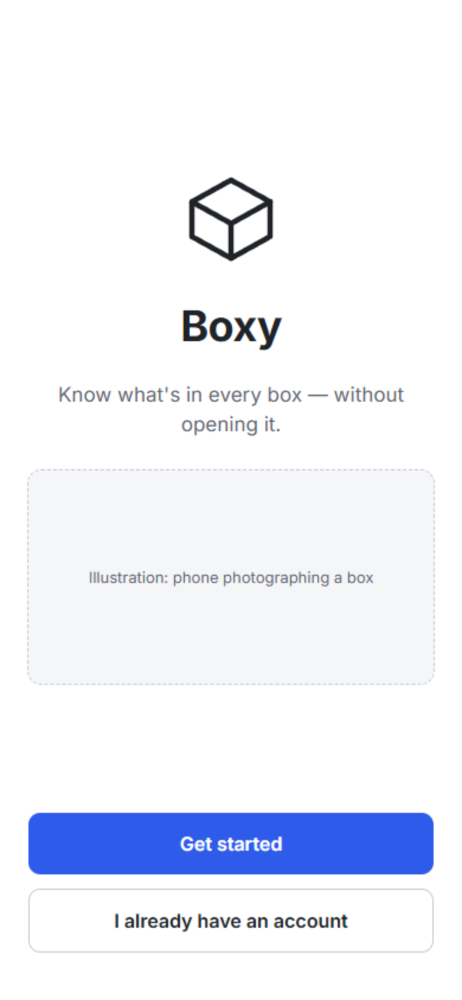 | 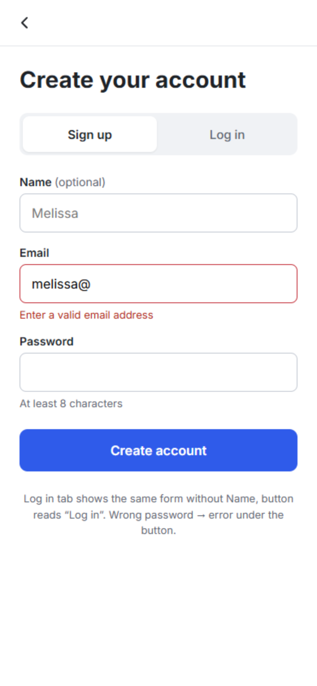 | 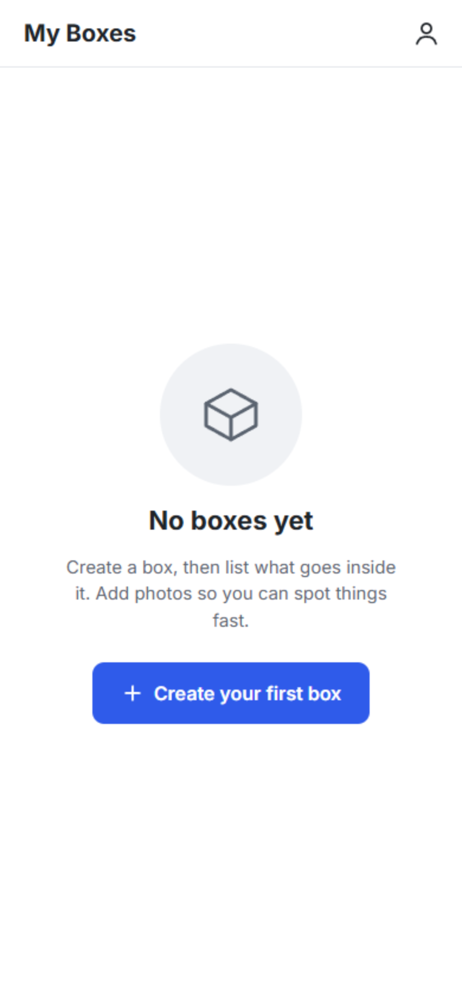 |

|                                 4 · My Boxes                                 |                                5 · New box                                 |                               6 · Box detail                                |
| :--------------------------------------------------------------------------: | :------------------------------------------------------------------------: | :-------------------------------------------------------------------------: |
| 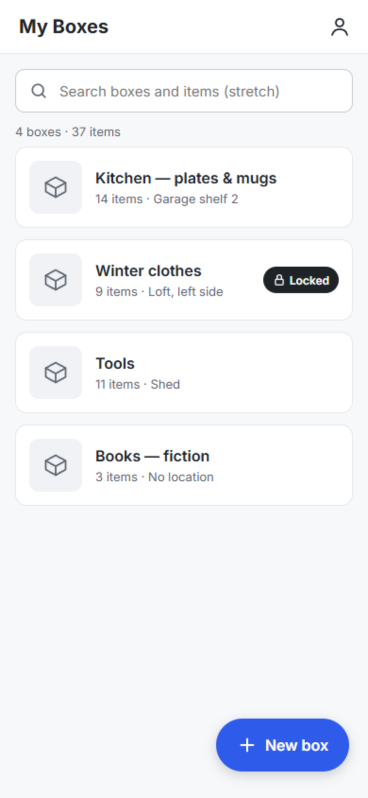 | 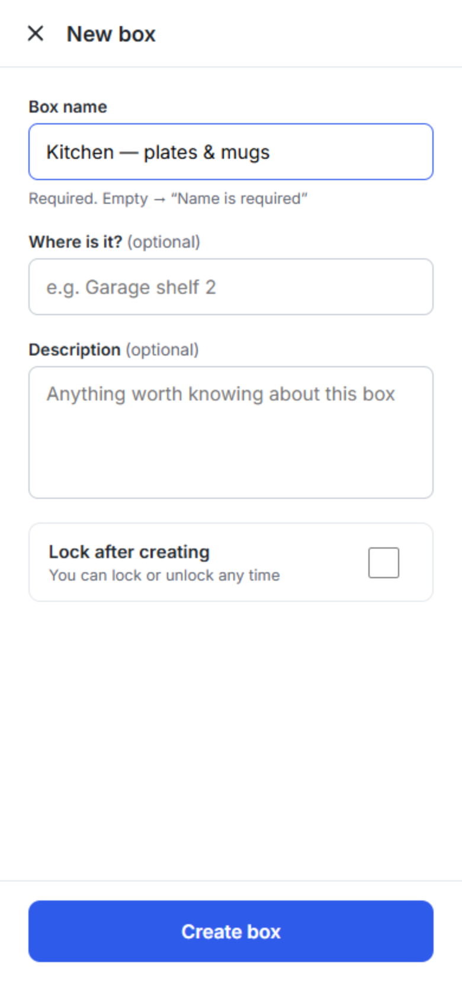 | 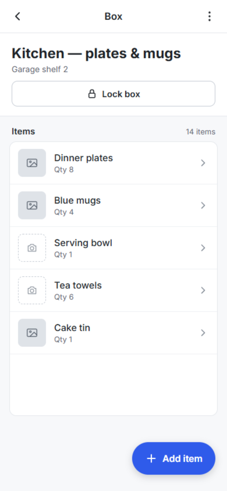 |

|                                         7 · Add item + photo                                         |                                8 · Item detail                                |                                  9 · Move item                                  |
| :--------------------------------------------------------------------------------------------------: | :---------------------------------------------------------------------------: | :-----------------------------------------------------------------------------: |
| 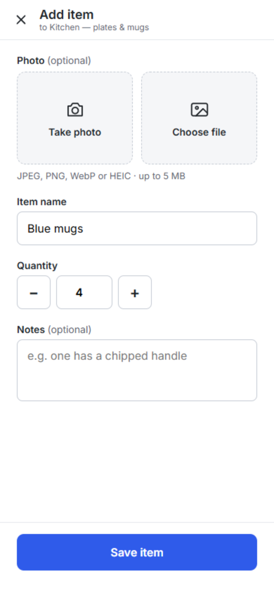 | 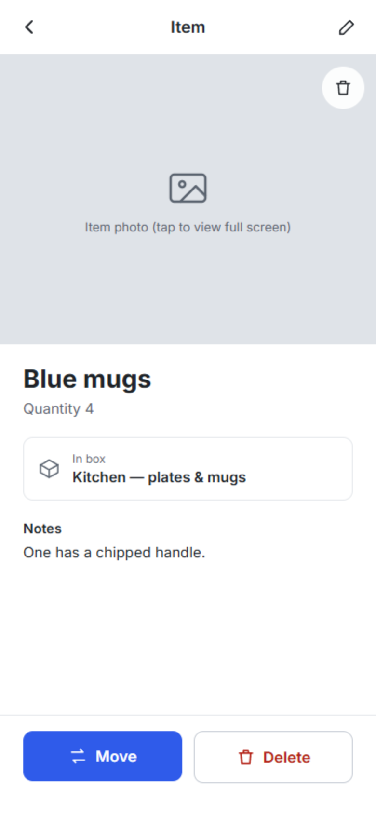 | 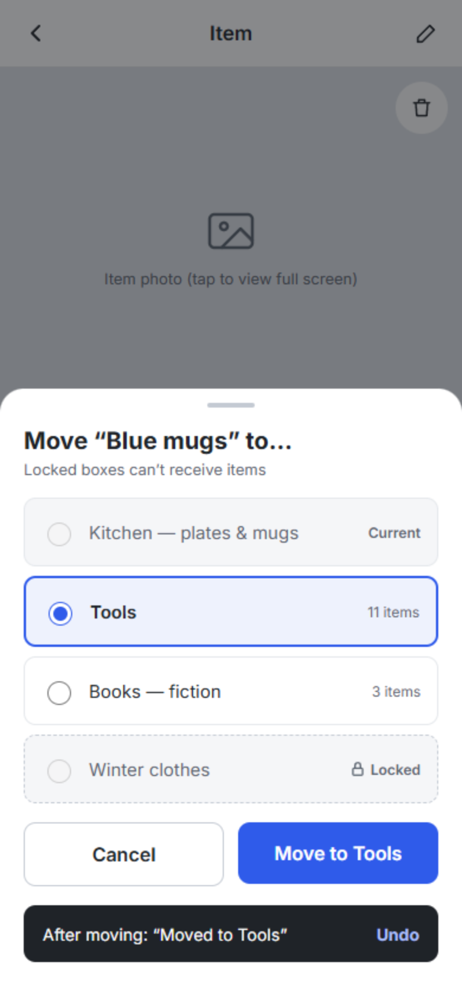 |

|                                       10 · Delete item                                       |                                 11 · Box detail — locked                                  |
| :------------------------------------------------------------------------------------------: | :---------------------------------------------------------------------------------------: |
| 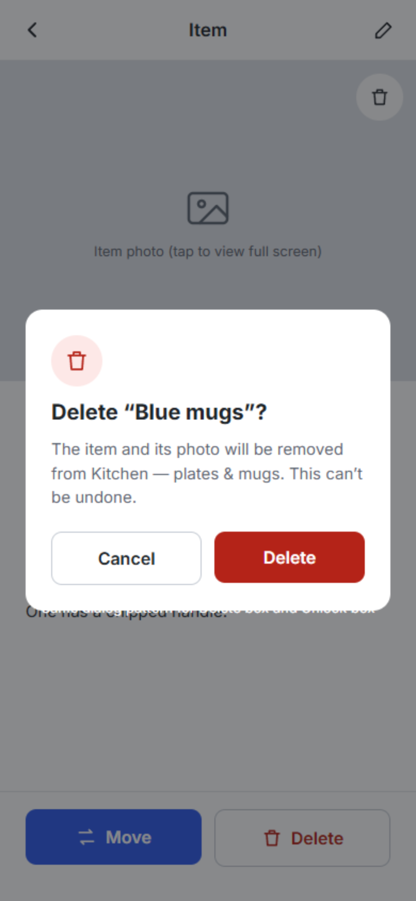 | 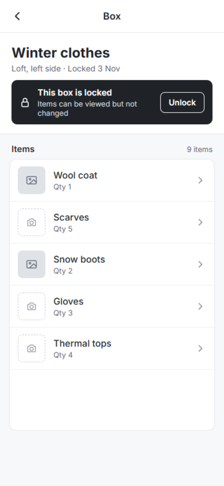 |

**UI conventions:** Inter font; greyscale with one blue accent (`#2f5bea`) for primary actions and red (`#b42318`) for destructive ones;
tap targets at least 44 × 44 px; the primary action sits bottom-right within thumb reach. At 768 px the box list becomes a 2-column grid
and item detail places the photo beside the details.

## How to Use

1. Create an account (or log in) from the welcome screen.
2. Tap **+ New box** and give it a name and, optionally, a location ("Where is it?") and description.
3. Open a box and tap **+ Add item**: add a name, quantity and notes, and take or choose a photo.
4. Open an item to **Move** it to another box (tap **Undo** within 5 seconds to reverse it) or **Delete** it.
5. Tap **Lock box** to freeze a box's contents. Tap **Unlock** on the banner to make changes again.

## Technologies

**Client**

- [React](https://react.dev/) with [Vite](https://vitejs.dev/)
- [React Router v6](https://reactrouter.com/) for routing and protected routes
- [Redux Toolkit](https://redux-toolkit.js.org/) for state (`authSlice`, `boxesSlice`, `itemsSlice` with async thunks)

**Server**

- [Node.js](https://nodejs.org/) and [Express](https://expressjs.com/)
- [PostgreSQL](https://www.postgresql.org/) via [`pg`](https://node-postgres.com/), using parameterised queries only
- [Passport.js](https://www.passportjs.org/) (local strategy), [`express-session`](https://github.com/expressjs/session) with [`connect-pg-simple`](https://github.com/voxpelli/node-connect-pg-simple), and [bcrypt](https://github.com/kelektiv/node.bcrypt.js) for password hashing
- [Multer](https://github.com/expressjs/multer) for uploads (5 MB limit, image MIME filter), stored in [Cloudinary](https://cloudinary.com/)
- [`express-validator`](https://express-validator.github.io/) for request validation
- [`helmet`](https://helmetjs.github.io/), [CORS](https://github.com/expressjs/cors) limited to the client origin, and [`express-rate-limit`](https://github.com/express-rate-limit/express-rate-limit) on the login route

**Testing and CI**

- [Jest](https://jestjs.io/) and [Supertest](https://github.com/ladjs/supertest) for API tests, against a separate `boxy_test` database
- [React Testing Library](https://testing-library.com/docs/react-testing-library/intro/) and [`user-event`](https://testing-library.com/docs/user-event/intro) for UI tests
- [MSW](https://mswjs.io/) to mock the API in client tests
- [Playwright](https://playwright.dev/) or [Cypress](https://www.cypress.io/) for end-to-end tests (stretch)
- [GitHub Actions](https://github.com/features/actions) with a Postgres service container

**Deployment**

- [Render](https://render.com/) for the API and Postgres database, with the client deployed as a static site

## Error Handling and Testing

All errors are returned as JSON in the form `{ "error": "message" }`. Implemented error handling for:

- `400 Bad Request` for validation errors
- `401 Unauthorized` when not logged in
- `404 Not Found` when a resource doesn't exist or isn't yours
- `423 Locked` for changes to a locked box

### 400 Bad Request

Request bodies are validated with `express-validator`. Examples: a box with no name ("Name is required"), a quantity that isn't a whole
number ≥ 1, a password shorter than 8 characters, or an upload that isn't JPEG/PNG/WebP/HEIC or is over 5 MB.

### 401 Unauthorized

Every route except signup, login and logout needs a session. `GET /api/auth/me` returns `401` when logged out, and the client's
`ProtectedRoute` redirects any `/boxes` route to `/login`.

### 404 Not Found

Every query is filtered by the `user_id` from the session, never from the request body. A box or item that belongs to someone else
returns `404` rather than `403`, so other users' IDs aren't revealed.

### 423 Locked

A single Express middleware, `assertBoxUnlocked`, guards every route that changes data. While a box is locked, it can't be edited or
deleted, its items can't be added, edited, deleted or have photos changed, and a transfer is refused if **either** the source or the
destination box is locked. The only change allowed is unlocking.

## Future Work

- Search across all boxes and items
- A printable QR code label for each box
- Multi-select move for several items at once
- Transfer history (a `transfers` table)
- Several photos per item (the `item_photos` table already allows for this)
